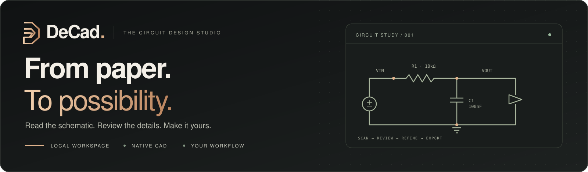
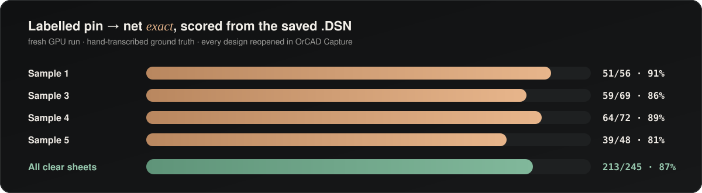
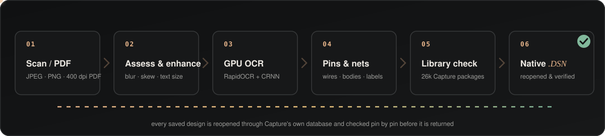
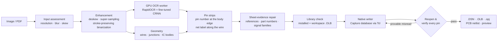

<div align="center">



<br/>

**Turn scanned schematics into circuits you can inspect, refine, and export.**

A local workspace for the whole journey: source images, component review, native CAD, and the details in between.

[](https://github.com/Mithunjagan/DeCad/stargazers)
[](#-quick-start)
[](#-how-it-works)

**[Get started](#-quick-start)** · **[Explore the studio](#-product-tour)** · **[Full screenshot gallery](docs/SCREENSHOTS.md)** · **[Measured results](#-measured-not-promised)** · **[How it works](#-how-it-works)**

<br/>

<a href="docs/screenshots/welcome.jpg"></a>

<sub>A little less friction. A lot more room for your next circuit.</sub>

</div>

---

## From a drawing to a design

Paper schematics hold years of engineering work. DeCad brings those drawings into a workspace where
you can inspect the recognized components, check physical pin connections, compare the source,
and generate a native design. Review stays part of the process, with uncertainties visible before export.

## ✨ Why DeCad

<table>
<tr>
<td width="33%" valign="top">

### 🔁 Verified, not guessed
Each saved design is **reopened through Capture's database** and compared pin by pin with what was
read. Misreads it can prove wrong are removed and reported: a pin the part lacks, or a pin on two nets.

</td>
<td width="33%" valign="top">

### 📏 Measured, not promised
Accuracy is scored **from the saved `.DSN`** against **hand-transcribed ground truth**, with
**245 labelled pin checkpoints**. The scorer, the ground truth and the results are all in this repo.

</td>
<td width="33%" valign="top">

### 🧩 Native, not an export hack
Real Capture parts from **26k installed library packages**, generated symbols when no library part
matches, a **PCB footprint on every part**, and output that passes Capture's PCB netlister.

</td>
</tr>
<tr>
<td valign="top">

### 🌫️ Scan-aware
One **Automatic** mode for every input. It measures resolution, character height, stroke blur and
skew, then picks the enhancement itself. You never switch settings by hand.

</td>
<td valign="top">

### ⚡ GPU when you have one
OCR runs in a **CUDA worker**: about **2× faster** on a 4 GB laptop RTX 3050, with identical scores.
It works on CPU too, and strict CUDA mode never falls back to CPU silently.

</td>
<td valign="top">

### 📚 Your libraries, used
Bring your own **`.OLB` libraries, `.DSN` designs, footprints and part maps**. Every generated
design places parts from them first and ships the footprints it used.

</td>
</tr>
</table>

## 📸 Product tour

Fresh captures of the running app · **24 October 2026** · Copper, Paper, Nebula, and Blueprint themes.
The logic-sheet views use a saved Sample 1 project; the screenshots show its actual review findings.

### Your circuit, with room to think

<a href="docs/screenshots/workspace.jpg"></a>

Projects on the left. Your design in the center. Commands and live resources on the right.
Switch into focus mode when the circuit needs the whole canvas.

### Keep the source in sight

<a href="docs/screenshots/source-comparison.jpg"></a>

Compare the original drawing with the saved reconstruction. Inspect the component list,
physical pin assignments, and review notes before applying changes.

<table>
<tr>
<td width="50%" valign="top"><a href="docs/screenshots/review-components.jpg"></a><br/><b>01 / Review the parts</b><br/><sub>References, values, and symbols remain editable.</sub></td>
<td width="50%" valign="top"><a href="docs/screenshots/review-connections.jpg"></a><br/><b>02 / Follow the connections</b><br/><sub>Search nets and inspect each physical pin.</sub></td>
</tr>
<tr>
<td valign="top"><a href="docs/screenshots/bom.jpg"></a><br/><b>03 / Know the parts</b><br/><sub>Inspect the BOM and follow supplier search links.</sub></td>
<td valign="top"><a href="docs/screenshots/component-database.jpg"></a><br/><b>04 / Bring your libraries</b><br/><sub>Search KiCad and OrCAD sources in one place.</sub></td>
</tr>
</table>

### A studio that feels like yours

<table>
<tr>
<td width="50%" valign="top"><a href="docs/screenshots/workspace-light.jpg"></a><br/><b>Paper</b><br/><sub>Warm surfaces and a quieter daylight workspace.</sub></td>
<td width="50%" valign="top"><a href="docs/screenshots/workspace-nebula.jpg"></a><br/><b>Nebula</b><br/><sub>Deep violet with luminous accents.</sub></td>
</tr>
</table>

**[Open the complete screenshot gallery →](docs/SCREENSHOTS.md)**

Welcome screens · imports · source comparison · review notes · BOM · nets · checks · source editor ·
libraries · command palette · history · applications · hardware monitor · focus mode · themes.

## 📊 Measured, not promised

<div align="center">

</div>

Fresh end-to-end run on the GPU, 2026-10-18 ([`tools/eval/results/claude-ocr3-gate`](tools/eval/results/claude-ocr3-gate)).
Every design was generated, saved, **reopened**, and scored from the reopened file.

| Input | Parts found | Precision | Values | Labelled pin → net exact | Time |
|---|---:|---:|---:|---:|---:|
| Sample 1 (clear) | 24/28 | 100% | 100% | **51/56 (91%)** | 53 s |
| Sample 3 (clear) | 30/34 | 97% | 93% | **59/69 (86%)** | 73 s |
| Sample 4 (clear) | 25/30 | 100% | 100% | **64/72 (89%)** | 49 s |
| Sample 5 (clear) | 22/25 | 100% | 95% | **39/48 (81%)** | 56 s |
| **All clear sheets** | | | | **213/245 (87%)** | |
| Sample 4, scanned PDF 300 dpi | 25/30 | 86% | 100% | 38/72 (53%) | 58 s |
| Sample 4, scanned PDF 200 dpi | 18/30 | 90% | 100% | 0/72 | 54 s |
| Sample 4, blurred PDF (σ = 2 px) | 12/30 | 80% | 100% | 0/72 | 55 s |

All 8 designs reopen cleanly, and all 8 pass Capture's PCB netlister (`pstswp`) with **0 errors**.

<details>
<summary><b>How to read these numbers</b></summary>

- *Labelled pin → net exact*: the pin exists in the saved design and sits on the hand-labelled net.
- Sample 2 (a 1600 px sheet with ~5 px text) has part-count ground truth only: TC514100 7/16,
  74F374 4/8, 74F244 2/4.
- Samples 1 and 3 contributed text crops to the fine-tuned reader. Samples 2, 4 and 5 are held out.
- Pin numbers on 200 dpi and blurred scans are the open problem (see the [roadmap](#-roadmap)).
  Those pages carry a "rescan at 300 dpi" review note.

</details>

## 🧠 How it works

<div align="center">

</div>



<details>
<summary><b>Where each stage lives</b></summary>

| Stage | Source |
|---|---|
| Input assessment, enhancement, OCR, bodies, pin strips, nets, repairs | `backend/app/digital_vision.py` |
| GPU worker dispatch and session verification | `backend/app/ocr_runtime.py`, `backend/app/ocr_worker.py` |
| Library matching with OCR-aware correction (`74F24U` → `74F240`) | `backend/app/orcad_capture.py`, `orcad_library.py` |
| Writing through Capture's database (`tclsh` + `orDb_Dll_Tcl64.dll`) | `backend/app/orcad_writer.tcl` |
| Reopen verification and physical netlist | `backend/app/orcad_dump.tcl`, `orcad_capture.py` |
| SVG preview of the saved design | `backend/app/orcad_render.tcl` |

In **Automatic** mode the logic-schematic recognizer runs first. If it finds no ICs and nets, the
simple discrete R/C/V recognizer (`circuit_vision.py`, Tesseract + OpenCV) takes over.

</details>

## 🚀 Quick start

> The OrCAD output needs **Windows** and a local **OrCAD X Capture** install. Without OrCAD, use the Docker setup (see *Docker* below).

| Requirement | Notes |
|---|---|
| Windows 10/11 | Tested on Windows 11 |
| [KiCad 10](https://www.kicad.org/download/windows/) | Default `D:\KICAD`, or set `S2SDN_KICAD_DIR`. Its Python 3.11 hosts the backend. |
| OrCAD X Capture 26.1 | Default `D:\tools`, or set `ORCAD_ROOT` |
| Node.js 20+ | Frontend (tested with Node 24) |
| *Optional:* NVIDIA GPU, CUDA 12 | For [GPU OCR](#-gpu-accelerated-ocr). 4 GB VRAM is enough. |

```powershell
git clone https://github.com/Mithunjagan/DeCad.git
cd DeCad
copy backend\.env.example backend\.env
powershell.exe -NoProfile -ExecutionPolicy Bypass -File .\start-native.ps1
```

Open **http://localhost:3100**. On first run, `start-native.ps1` builds `backend\.venv` from KiCad's
Python, installs the requirements, and starts the API on **:8100** and the workbench on **:3100**.

For a desktop icon that starts everything in its own window, run
`powershell.exe -ExecutionPolicy Bypass -File .\install-desktop-app.ps1` once. Stop everything with `stop.ps1`.

### Your first conversion

1. Create a project, then open **Libraries & footprints**.
2. Drop a drawing on **Blueprint → OrCAD Capture**. Try `samples/orcad/Sample 4.jpg.jpeg`.
3. The **OrCAD Capture design** dialog shows:
   - the verification badge, parts, pins and nets;
   - PCB footprint coverage;
   - the drawing rendered back from the saved file;
   - a searchable physical netlist, downloadable as `.net` or `.csv`.
4. Click **Open in OrCAD Capture**. In the tree, expand `<design>.dsn` → `SCHEMATIC1` and double-click `PAGE1`.

To review the read first, attach the file in the assistant and send `convert to OrCAD` instead. The
**Review circuit** dialog lets you:
- compare with the source;
- edit one net at a time;
- then **Generate verified OrCAD .DSN**.

## ⚡ GPU-accelerated OCR

Recognition runs in a separate **CUDA Python** (`S2SDN_OCR_PYTHON`), independent of KiCad's Python.
Each job runs as a hidden worker process. The worker checks which provider each ONNX session actually
uses before it reports `cuda`, and frees GPU memory when it exits.

```powershell
py -3.12 -m venv backend\.state\gpu-venv
$py = "backend\.state\gpu-venv\Scripts\python.exe"
& $py -m pip install -r backend\requirements.txt
& $py -m pip install --no-deps -r backend\requirements-ocr.txt
& $py -m pip uninstall -y onnxruntime
& $py -m pip install onnxruntime-gpu==1.22.0
& $py -m pip install torch==2.5.1 --index-url https://download.pytorch.org/whl/cu121   # CUDA 12 / cuDNN 9 DLLs
```

```ini
# backend/.env
S2SDN_OCR_PYTHON=D:/path/to/DeCad/backend/.state/gpu-venv/Scripts/python.exe
S2SDN_OCR_DEVICE=cuda      # strict: fail loudly instead of falling back to CPU
IMAGE_MODE=auto
```

| Sample 1, live app | Time | Exact pins |
|---|---:|---:|
| CPU | 98.8 s | 51/56 |
| **RTX 3050 Laptop (4 GB)** | **49.8 s** | **51/56** |

The status route `GET /api/vision/status` reports the verified device and each session's providers.
Sessions use a bounded memory arena with a heuristic convolution search, because RapidOCR's defaults
can exhaust a 4 GB card.

## 🧰 Everything else in the box

| | |
|---|---|
| 📚 **Libraries & footprints** | Drop `.OLB` libraries, existing `.DSN` designs (their parts are extracted), Allegro/KiCad footprints, or a part map like `74F174 → soic16`. |
| 🔎 **Find any component** | Unified KiCad + OrCAD search. It acquires permitted assets, validates pin-to-pad mapping, and saves the symbol and footprint into your project. |
| 🖥️ **Native KiCad, docked** | The real `eeschema` runs inside the DeCad window, next to the project list and assistant. |
| 💬 **Assistant** | `create a voltage divider` · `add U1 74xx:74LS244` · `connect R1 pin 2 to C1 pin 1` · `run ERC` · `undo` |
| 📈 **Simulation** | ngspice, or a built-in MNA transient solver, with an oscilloscope view |
| 📦 **Exports** | KiCad · OrCAD `.DSN` · Specctra DSN (Freerouting) · EDIF · SPICE · BOM · netlists · LTspice/Qucs-S bundles |
| 🕓 **History** | Local Git commits, plus optional GitHub push |

## 🔬 Reproducing the evaluation

```powershell
$py = "backend\.state\gpu-venv\Scripts\python.exe"   # or backend\.venv\Scripts\python.exe (CPU)

& $py tools\eval\run_eval.py 1 2 3 4 5 --out tools\eval\results\my-run          # clear samples
& $py tools\eval\make_degraded.py 4                                              # 300/200 dpi + blurred PDFs
& $py tools\eval\run_eval.py --images tools\eval\degraded --variant scan300 4 --out tools\eval\results\my-run
& $py tools\eval\codex_verify.py my-gate --baseline tools\eval\results\claude-ocr3-gate\report.json   # full gate
```

Each run writes `report.md` and `report.json`. For every input it also saves the design,
`recognized.json`, `ocr-tokens.json` and `pin-debug.json`. Run one evaluation at a time on 8 GB machines.

<details>
<summary><b>⚙️ Configuration reference</b></summary>

`backend/.env` (template: `backend/.env.example`). It is git-ignored; never commit it.

| Variable | Purpose |
|---|---|
| `IMAGE_MODE` | Default recognizer: `auto` (recommended), `digital`, `circuit`, `ocr`, `vision` |
| `S2SDN_OCR_PYTHON` / `S2SDN_OCR_DEVICE` | OCR worker Python, and `cuda` (strict), `cpu`, or unset for auto |
| `S2SDN_CUDA_DLLS` | Extra folder with CUDA 12 / cuDNN 9 DLLs |
| `S2SDN_TEXT_MODEL` | Override path of the fine-tuned reader |
| `ORCAD_ROOT` / `S2SDN_KICAD_DIR` | OrCAD and KiCad install roots |
| `TESSERACT_DIR` | Tesseract folder, if not in a default location |
| `ALLOW_LOCAL_LOGIN` | Local workspace without GitHub sign-in |
| `GITHUB_CLIENT_ID` / `GITHUB_CLIENT_SECRET` | Optional OAuth for pushing projects |
| `OLLAMA_URL`, `CHAT_MODEL` | Optional local language model for the assistant |
| `CHAT_API_URL`, `NVIDIA_API_KEY`, `CHAT_API_MODEL` | Optional cloud chat for explanations and planning only. Recognition always stays local. |

</details>

<details>
<summary><b>🔌 HTTP API</b></summary>

The frontend reaches the backend through a same-origin `/api` proxy.

| Method | Route | Purpose |
|---|---|---|
| `POST` | `/projects/{pid}/orcad/auto` | Attachment → recognize → write → verify (`{"attachment": "references/x.jpg", "recognition_mode": "auto"}`) |
| `POST` | `/projects/{pid}/export/orcad-dsn` | Reviewed circuit JSON → verified `.DSN` zip |
| `GET` | `/projects/{pid}/orcad` | Last design status: `passed`, `checked_pins`, `corrections`, `footprints`, … |
| `GET` | `/projects/{pid}/orcad/preview.svg` · `/orcad/netlist` · `/orcad/download` | Preview, physical netlist, design zip |
| `POST` | `/projects/{pid}/orcad/open` | Open in the installed Capture |
| `GET` | `/vision/status` | Recognizer mode and verified OCR runtime |
| `POST` | `/ai/chat` | Assistant with attachments and `recognition_mode` |
| `POST` | `/library/upload` | Add `.OLB` / `.DSN` / footprints / part map / zip |
| `GET` | `/components/search` | Unified component search |

Full list: `backend/app/main.py`.

</details>

<details>
<summary><b>🗂️ Repository layout</b></summary>

```text
backend/app/      FastAPI app, recognizers, GPU worker, OrCAD Tcl scripts, libraries
backend/tests/    pytest suite
frontend/app/     Next.js 16 / React 19 workbench
desktop/ bridge/  native Windows host (docked KiCad, WebView2) and desktop bridge
checkpoints/      schematic-ocr (CRNN, ONNX + PyTorch) · circuit-lora (experimental VLM adapter)
samples/orcad/    the five evaluation schematics
tools/eval/       ground truth, scorer, degraded-scan generator, gates, results
training/         CRNN and LoRA training (local GPU + Colab notebooks)
docs/media/       README graphics
```

</details>

<details>
<summary><b>🐳 Docker (without OrCAD)</b></summary>

On macOS, Linux or Windows, the containers provide KiCad editing, simulation, exports and the CPU
recognizers. They do not write OrCAD designs.

```sh
./start.command                                         # macOS / Linux
powershell -ExecutionPolicy Bypass -File .\start.ps1    # Windows
```

Ports: 3100 (workbench), 8100 (API), 6180 (embedded KiCad), and optionally 11434 (Ollama).

</details>

<details>
<summary><b>🧪 Development and tests</b></summary>

```powershell
cd backend;  .venv\Scripts\python.exe -m pytest tests -q
cd frontend; npm ci; npm test; npm run dev
```

Measure every recognition change end-to-end with `tools/eval/codex_verify.py`. Gains on single text
crops have lowered end-to-end wiring scores before.

</details>

## 🤖 Models

| Model | Role |
|---|---|
| **RapidOCR** (PaddleOCR det/cls/rec on ONNX Runtime) | Primary text detection and reading, on CUDA or CPU |
| **Schematic CRNN** (`checkpoints/schematic-ocr`) | Second reader for pin numbers, references and labels. Trained with `training/schematic_ocr.py` on synthetic plotter-font text plus confident real crops: about 2 min on a 4 GB GPU. |
| **Qwen2.5-VL LoRA** (`checkpoints/circuit-lora`) | Experimental whole-image extraction. Not used for OrCAD output: it failed the reference wiring check ([details](WINDOWS_VISION.md)). |

For longer runs, use the Colab notebooks in `training/`. Build their upload bundle with `python tools/build_colab_bundle.py`.

## 🧭 Roadmap

- [x] Native OrCAD Capture `.DSN` with reopen-and-verify
- [x] PCB footprint on every part; PCB netlister passes with 0 errors
- [x] Automatic handling of low-resolution and blurred scans
- [x] CUDA OCR worker with verified sessions
- [x] 87% exact labelled pins on clear sheets
- [ ] **Pin numbers on blurred / 200 dpi scans**: infer them from the library pinout when digits are unreadable
- [ ] Recover ICs dropped on blurry pages
- [ ] Multi-sheet designs with hierarchical ports
- [ ] Broader ground truth beyond the five evaluation sheets

## ⚠️ Limitations

- **Always review before use.** 87% of labelled pins are exact on clear sheets, and far fewer on
  degraded scans. The review dialog and the `corrections` list show what is uncertain.
- OrCAD output needs Windows, a local OrCAD X Capture installation, and the native backend.
- The discrete R/C/V recognizer covers clean resistor, capacitor and source drawings only.
- Allegro geometry (`.dra`, `.psm`, `.brd`) is cataloged but not converted.
- The desktop services are for one local user. Do not expose ports 3100/8100 publicly.

## 📖 Documentation

[Screenshot gallery](docs/SCREENSHOTS.md) · [DEMO.md](DEMO.md) (demo runbook) · [ORCAD_STATUS.md](ORCAD_STATUS.md) (pipeline internals) ·
[COMPONENT_LIBRARIES.md](COMPONENT_LIBRARIES.md) · [WINDOWS_VISION.md](WINDOWS_VISION.md) ·
[SPECCTRA.md](SPECCTRA.md) · [RELEASE_GATES.md](RELEASE_GATES.md) · [STATUS.md](STATUS.md) (dated log) ·
[THIRD_PARTY.md](THIRD_PARTY.md)

## 🤝 Contributing

Issues and pull requests are welcome, especially:
- new hand-transcribed ground truth sheets;
- blurred-scan pin recovery;
- support for more EDA formats.

Please measure recognition changes end-to-end with the gate before opening a PR.

<div align="center">

### ⭐ If DeCad saves you from redrawing a schematic, star the repo. It helps others find it.

<br/>

<sub>OrCAD, Capture and Allegro are trademarks of Cadence Design Systems. OrCAD itself is not distributed.
KiCad, ngspice, RapidOCR and the other components are used under their own licenses (see <a href="THIRD_PARTY.md">THIRD_PARTY.md</a>).
<b>License:</b> proprietary, all rights reserved by the authors, until an open-source license is designated.</sub>

</div>
