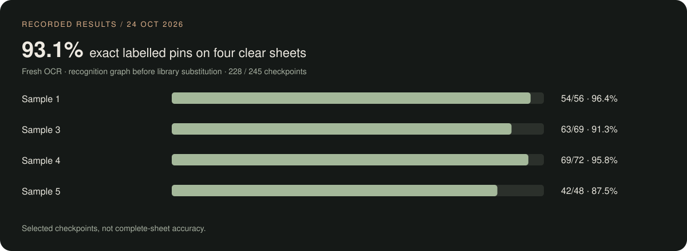
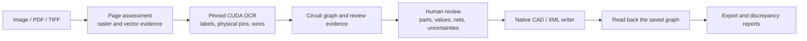

<div align="center">

<picture>
<source media="(prefers-reduced-motion: reduce)" srcset="docs/media/studio-hero.svg"/>

</picture>

<br/>

**Turn scanned schematics into circuits you can inspect, refine, and export.**

A local workspace for the whole journey: source images, component review, native CAD, and the details in between.


[](#-quick-start)
[](#-how-it-works)

**[Setup guide](docs/SETUP.md)** · **[Get started](#-quick-start)** · **[Explore the studio](#-product-tour)** · **[Full screenshot gallery](docs/SCREENSHOTS.md)** · **[Measured results](#-measured-not-promised)** · **[How it works](#-how-it-works)**

<br/>

<a href="docs/SCREENSHOTS.md"><picture>
<source media="(prefers-reduced-motion: reduce)" srcset="docs/screenshots/welcome.jpg"/>

</picture></a>

<sub>A little less friction. A lot more room for your next circuit. An 18-second tour of actual UI captures.</sub>

<sub><a href="docs/SCREENSHOTS.md">Explore every screen</a> · <a href="docs/screenshots/welcome.jpg">View the static welcome screen</a></sub>

</div>

---

## From a drawing to a design

Paper schematics hold years of engineering work. DeCad brings those drawings into a workspace where
you can inspect the recognized components, check physical pin connections, compare the source,
and generate a native design. Review stays part of the process, with uncertainties visible before export.

## ✨ Why DeCad

| A workspace for real circuit work | What you can inspect |
|---|---|
| **Source-aware review** | Component values, physical pin IDs, source comparisons, and explicit unresolved evidence. |
| **Native CAD output** | KiCad schematics and Capture `.DSN` files, with graph readback checks separate from recognition scores. |
| **Your component libraries** | KiCad and OrCAD sources, workspace libraries, footprint properties, and package review requirements. |
| **Measured GPU execution** | A separate CUDA OCR worker records the providers actually used by its sessions. |
| **A complete local workbench** | Projects, assistant commands, BOM, nets, electrical checks, local history, and simulation tools. |

The current production profile is pinned in `backend/pipeline_profiles.json`. Install requirements,
the separate OCR model asset, and the limits of the recorded results are described below.

## 📸 Product tour

Fresh captures of the running app · **24 October 2026** · Copper, Paper, Nebula, and Blueprint themes.
The logic-sheet views use a saved Sample 1 project; the screenshots show its actual review findings.

### Your circuit, with room to think

<a href="docs/screenshots/workspace.jpg"></a>

Projects on the left. Your design in the center. Commands and live resources on the right.
Switch into focus mode when the circuit needs the whole canvas.

### Keep the source in sight

<a href="docs/screenshots/source-comparison.jpg"></a>

Compare the original drawing with the saved reconstruction. Inspect the component list,
physical pin assignments, and review notes before applying changes.

<table>
<tr>
<td width="50%" valign="top"><a href="docs/screenshots/review-components.jpg"></a><br/><b>01 / Review the parts</b><br/><sub>References, values, and symbols remain editable.</sub></td>
<td width="50%" valign="top"><a href="docs/screenshots/review-connections.jpg"></a><br/><b>02 / Follow the connections</b><br/><sub>Search nets and inspect each physical pin.</sub></td>
</tr>
<tr>
<td valign="top"><a href="docs/screenshots/bom.jpg"></a><br/><b>03 / Know the parts</b><br/><sub>Inspect the BOM and follow supplier search links.</sub></td>
<td valign="top"><a href="docs/screenshots/component-database.jpg"></a><br/><b>04 / Bring your libraries</b><br/><sub>Search KiCad and OrCAD sources in one place.</sub></td>
</tr>
</table>

### A studio that feels like yours

<table>
<tr>
<td width="50%" valign="top"><a href="docs/screenshots/workspace-light.jpg"></a><br/><b>Paper</b><br/><sub>Warm surfaces and a quieter daylight workspace.</sub></td>
<td width="50%" valign="top"><a href="docs/screenshots/workspace-nebula.jpg"></a><br/><b>Nebula</b><br/><sub>Deep violet with luminous accents.</sub></td>
</tr>
</table>

**[Open the complete screenshot gallery →](docs/SCREENSHOTS.md)**

Welcome screens · imports · source comparison · review notes · BOM · nets · checks · source editor ·
libraries · command palette · history · applications · hardware monitor · focus mode · themes.

<!-- BEGIN GENERATED MEASUREMENTS -->
## 📊 Measured, not promised



**Recorded clear-sheet result: 228/245 labelled pin → net assignments exact (93.1%).**

Measured on **24 October 2026**, with a fresh, process-isolated CUDA OCR gate. These scores
measure recognized graphs **before CAD library substitution**. They cover four clear sheets and
selected labelled pin checkpoints, rather than complete-circuit accuracy. Later source changes
and the code-test results below do not constitute another OCR benchmark.

| Input | Matched parts / truth | Extra detections | Correct values / matched parts | Exact labelled pins | Worker time |
|---|---:|---:|---:|---:|---:|
| Sample 1 | 24/28 | 0 | 24/24 | **54/56 (96.4%)** | 159.8 s |
| Sample 3 | 30/34 | 1 | 29/30 | **63/69 (91.3%)** | 161.5 s |
| Sample 4 | 25/30 | 0 | 23/25 | **69/72 (95.8%)** | 161.4 s |
| Sample 5 | 22/25 | 0 | 21/22 | **42/48 (87.5%)** | 287.2 s |
| Sample 4 · 300 dpi | 25/30 | 4 | 23/25 | **44/72 (61.1%)** | 231.3 s |
| Sample 4 · 200 dpi | 18/30 | 2 | 17/18 | **0/72 (0.0%)** | 195.0 s |
| Sample 4 · blurred | 12/30 | 3 | 12/12 | **0/72 (0.0%)** | 188.3 s |

Sample 2 has no labelled-pin denominator in this report and is excluded from the aggregate.
The 200 dpi and blurred inputs still have **0/72 exact labelled assignments**; a valid export does
not repair an unread source. Timings belong to this recorded run and are not a speed guarantee.

**Export and appearance checks are separate measurements:**

| Recorded check | Result | What it establishes |
|---|---|---|
| Observed-graph OrCAD export regression | **19/19 cases; 2,229 pin memberships** | Saved native output preserves the supplied graph; this is not fresh recognition. |
| Faculty XML closure corpus | **18/18 exports** | XML serialization/readback, including 37 explicitly provisional terminals. TD9 application import is unverified. |
| Detailed source-appearance audits | **0/3 source-faithful** | Electrical checks passed, while symbol, geometry, or junction discrepancies still need review. |
| One saved-design footprint repair | **24/24 assigned; native PCB netlisting passed** | Five suggested packages still require physical package review. This is one case, not a corpus-wide PCB certification. |

Inspect the [raw recognition report](evidence/release-20261024/recognition-report.json),
[gate](evidence/release-20261024/recognition-gate.json),
[export summary](evidence/release-20261024/native-export-summary.json), and
[measurement definitions](docs/RESULTS.md). The [machine-readable metrics](docs/data/metrics.json)
and this chart are generated from those records with `python tools/update_readme_stats.py`.

<!-- END GENERATED MEASUREMENTS -->

### Code and setup validation for this update

| Check | Verified result | Scope |
|---|---|---|
| Backend | **478 distinct passing cases; 6 skipped** | A full run plus focused reruns after two native export fixes; the full suite was not repeated after those fixes. |
| Frontend | **22/22 tests; production compilation passed** | Built in an isolated directory; standalone packaging emitted path-tracing warnings and was not deployment-tested. |
| Native setup | **15/15 prerequisite/service checks** | This installed Windows machine; a deliberately missing KiCad path was also correctly rejected. |

See the [validation receipt](evidence/release-20261024/validation.json) for commands and limits.
These checks do not replace the dated recognition measurements above or certify a clean-machine install.

## 🧠 How it works



The pinned `hybrid_max_accuracy` pipeline combines OCR, geometric evidence, library facts,
and bounded regional model requests where configured. Its primary and fallback regional
endpoints are defined in `backend/pipeline_profiles.json`; availability does not establish accuracy.
The reviewed graph feeds the exporters. Source geometry and native pin connectivity have
separate audits, so an electrical pass can still carry visible drawing discrepancies.

| Stage | Source |
|---|---|
| Pinned configuration and checkpoint digest | `backend/pipeline_profiles.json`, `backend/app/pipeline_profile.py` |
| Raster/vector interpretation and physical pins | `backend/app/digital_vision.py`, `backend/app/ingestion.py` |
| Isolated OCR runtime and provider verification | `backend/app/ocr_runtime.py`, `backend/app/ocr_worker.py` |
| Native Capture writing and readback | `backend/app/orcad_capture.py`, `backend/app/orcad_writer.tcl` |
| Observed graph export and package review | `backend/app/observed_export.py` |
| Source wires, symbols, and appearance audit | `backend/app/orcad_source_wires.py`, `backend/app/orcad_source_symbols.py`, `backend/app/orcad_visual_audit.py` |

## 🚀 Quick start

**[Read the complete Windows setup guide →](docs/SETUP.md)**

The published native workflow needs Windows, KiCad 10, Node.js 20.9+, a separate Python 3.12 CUDA
OCR environment, and the accepted OCR checkpoint. Native Capture output also needs your own
licensed OrCAD installation. **The code clone does not include model weights or CAD applications.**

```powershell
git clone https://github.com/Mithunjagan/DeCad.git
cd DeCad
```

Follow [the setup guide](docs/SETUP.md) to install the backend and frontend dependencies, place the
checkpoint, and configure `backend/.env` using [the example](backend/.env.example). Then:

```powershell
powershell.exe -NoProfile -ExecutionPolicy Bypass -File .\tools\check_setup.ps1 -RequireOrcad
powershell.exe -NoProfile -ExecutionPolicy Bypass -File .\start-native.ps1
```

Open **http://localhost:3100**, choose **Open local workspace**, and create a project. Try
`create a voltage divider`, then attach a source drawing for recognition. Compare the parts and
pin connections in **Review circuit**, choose an export target, and inspect the saved design's
readback and discrepancy reports. For Capture, open the design's `SCHEMATIC1 → PAGE1` page.

The guide includes custom installation paths, GPU setup, health checks, the desktop shortcut,
first conversion, and troubleshooting. The checker is read-only; it does not install software.

## ⚡ GPU-accelerated OCR

The production profile requests **CUDA**, validates the accepted ONNX checkpoint digest, and uses
a separate worker so the backend's KiCad Python keeps its own dependencies. A completed job
records the execution providers its sessions actually used. A configured worker is not proof of
GPU execution, and a strict CUDA failure does not silently turn into a CPU result.

See the [CUDA environment instructions](docs/SETUP.md#5-create-the-separate-cuda-ocr-environment).
Inspect `GET /api/vision/status` after a recognition job for the device, state, errors, and providers.
The timings in the results table belong to the recorded October 24 run; the old CPU/GPU comparison
is no longer used as the current performance headline.

## 🧰 Everything else in the box

| | |
|---|---|
| 📚 **Libraries & footprints** | Drop `.OLB` libraries, existing `.DSN` designs (their parts are extracted), Allegro/KiCad footprints, or a part map like `74F174 → soic16`. |
| 🔎 **Find any component** | Unified KiCad + OrCAD search. It acquires permitted assets, validates pin-to-pad mapping, and saves the symbol and footprint into your project. |
| 🖥️ **Native KiCad, docked** | The real `eeschema` runs inside the DeCad window, next to the project list and assistant. |
| 💬 **Assistant** | `create a voltage divider` · `add U1 74xx:74LS244` · `connect R1 pin 2 to C1 pin 1` · `run ERC` · `undo` |
| 📈 **Simulation** | ngspice, or a built-in MNA transient solver, with an oscilloscope view |
| 📦 **Exports** | KiCad · OrCAD `.DSN` · Specctra DSN (Freerouting) · EDIF · SPICE · BOM · netlists · LTspice/Qucs-S bundles |
| 🕓 **History** | Local Git commits, plus optional GitHub push |

## 🔬 Reproducing and checking results

The published numbers are backed by [dated evidence files](evidence/release-20261024/README.md).
Check their arithmetic and regenerate the README chart without running inference:

```powershell
python tools\update_readme_stats.py --check
python tools\update_readme_stats.py
```

For a new recognition run, use the installed OCR Python and a **new output directory**:

```powershell
$ocrPython = 'backend\.state\gpu-venv\Scripts\python.exe'
& $ocrPython tools\eval\profile_eval.py recognition_gate 1 3 4 5 --out evidence\my-clear-run
```

Run one GPU gate at a time. A new gate needs the input images and matching ground truth; tests
and regenerated documentation do not substitute for fresh recognition. See
[measurement definitions](docs/RESULTS.md) and [recognition configuration](docs/GENERAL_RECOGNITION.md)
for partial truth, degraded inputs, full-graph evaluation, and explicit vision mode.

For your own corpus, provide independently checked references and run:

```powershell
& $ocrPython tools\eval\run_corpus.py path\to\manifest.json --out evidence\my-corpus --mode hybrid_max_accuracy
```

The evaluator measures recognized components, exact values, physical pins, topology, false joins,
missing connections, named nets, and exact whole graphs. Incomplete references cannot establish
full-sheet accuracy. CAD export/readback and source-appearance checks remain separate.

<details>
<summary><b>⚙️ Configuration reference</b></summary>

`backend/.env` (template: `backend/.env.example`). It is git-ignored; never commit it.

| Variable | Purpose |
|---|---|
| `IMAGE_MODE` | Owned by the production `hybrid_max_accuracy` profile; explicit API recognition modes remain available |
| `S2SDN_OCR_PYTHON` / `S2SDN_OCR_DEVICE` | OCR worker Python, and `cuda` (strict), `cpu`, or unset for auto |
| `S2SDN_CUDA_DLLS` | Extra folder with CUDA 12 / cuDNN 9 DLLs |
| `S2SDN_TEXT_MODEL` | Owned by the pinned production profile and verified against its digest |
| `ORCAD_ROOT` / `S2SDN_KICAD_DIR` | OrCAD and KiCad install roots |
| `TESSERACT_DIR` | Tesseract folder, if not in a default location |
| `ALLOW_LOCAL_LOGIN` | Local workspace without GitHub sign-in |
| `GITHUB_CLIENT_ID` / `GITHUB_CLIENT_SECRET` | Optional OAuth for pushing projects |
| `OLLAMA_URL`, `CHAT_MODEL` | Optional local language model for the assistant |
| `CHAT_API_URL`, `NVIDIA_API_KEY`, `CHAT_API_MODEL` | Optional chat configuration; separate from regional recognition endpoints. Keep credentials in local environment files. |

</details>

<details>
<summary><b>🔌 HTTP API</b></summary>

The frontend reaches the backend through a same-origin `/api` proxy.

| Method | Route | Purpose |
|---|---|---|
| `POST` | `/projects/{pid}/orcad/auto` | Attachment → recognize → write → verify (`{"attachment": "references/x.jpg", "recognition_mode": "auto"}`) |
| `POST` | `/projects/{pid}/export/orcad-dsn` | Reviewed circuit JSON → verified `.DSN` zip |
| `GET` | `/projects/{pid}/orcad` | Last design status: `passed`, `checked_pins`, `corrections`, `footprints`, … |
| `GET` | `/projects/{pid}/orcad/preview.svg` · `/orcad/netlist` · `/orcad/download` | Preview, physical netlist, design zip |
| `POST` | `/projects/{pid}/orcad/open` | Open in the installed Capture |
| `GET` | `/vision/status` | Recognizer mode and verified OCR runtime |
| `POST` | `/ai/chat` | Assistant with attachments and `recognition_mode` |
| `POST` | `/library/upload` | Add `.OLB` / `.DSN` / footprints / part map / zip |
| `GET` | `/components/search` | Unified component search |

Full list: `backend/app/main.py`.

</details>

<details>
<summary><b>🗂️ Repository layout</b></summary>

```text
backend/app/      FastAPI app, recognizers, GPU worker, OrCAD Tcl scripts, libraries
backend/tests/    pytest suite
frontend/app/     Next.js 16 / React 19 workbench
desktop/ bridge/  native Windows host (docked KiCad, WebView2) and desktop bridge
checkpoints/      schematic-ocr (CRNN, ONNX + PyTorch) · circuit-lora (experimental VLM adapter)
samples/orcad/    the five evaluation schematics
tools/eval/       ground truth, scorer, degraded-scan generator, gates, results
training/         CRNN and LoRA training (local GPU + Colab notebooks)
docs/media/       README graphics
docs/data/        generated measurement summaries
docs/SETUP.md     native installation and troubleshooting
evidence/release-20261024/  published measurement receipts
```

</details>

<details>
<summary><b>🐳 Docker (without OrCAD)</b></summary>

Docker configuration remains in the repository, but the current containers do not package the
complete pinned checkpoint/CUDA profile. Docker and CPU-only startup have not been validated for
this release. Use the [native Windows setup guide](docs/SETUP.md) for the published workflow.

The historical container entry points are `start.command` and `start.ps1`.
They are not the verified native launcher.

Ports: 3100 (workbench), 8100 (API), 6180 (embedded KiCad), and optionally 11434 (Ollama).

</details>

<details>
<summary><b>🧪 Development and tests</b></summary>

```powershell
$env:KICAD_CLI = 'D:\KICAD\bin\kicad-cli.exe'
$env:KICAD_SYMBOL_DIR = 'D:\KICAD\share\kicad\symbols'
$env:KICAD_FOOTPRINT_DIR = 'D:\KICAD\share\kicad\footprints'
Push-Location backend
& .venv\Scripts\python.exe -m pytest tests -q
Pop-Location
Push-Location frontend
npm test
npm run build
Pop-Location
```

Configure the installed CAD paths before running integration tests. Use the dated recognition
gates for image-interpretation claims; code tests alone do not measure OCR accuracy.

</details>

## 🤖 Models and runtime boundaries

| Component | Role |
|---|---|
| RapidOCR / ONNX Runtime | Text detection and reading; the production worker verifies CUDA session execution. |
| Accepted schematic CRNN checkpoint | Second reader for schematic text; separately supplied, pinned by SHA-256, and not changed by this repository update. |
| Regional vision readers | Optional bounded requests configured in `backend/pipeline_profiles.json`; installation and model availability are not accuracy evidence. |
| Experimental training adapters | Research artifacts described under `training/`; they do not replace the accepted production checkpoint. |

Converted AMSnet records now require independent source-image review. Parsing a SPICE netlist
does not establish that its values and physical pin connections match the paired image.

## 🧭 Roadmap

- [x] Native graph exports with saved-file readback and explicit discrepancy reports.
- [x] Reviewed component/pin graphs and preservation of provisional evidence.
- [x] CUDA OCR workers with provider verification.
- [x] Recorded 228/245 exact labelled checkpoints across four clear sheets.
- [ ] Recover unread pin assignments on blurred and 200 dpi inputs.
- [ ] Resolve source symbol, route, and junction discrepancies in the detailed visual audits.
- [ ] Verify physical package suitability beyond footprint property assignment.
- [ ] Broaden complete, independent ground truth across more drawings and circuit families.
- [ ] Validate a portable CPU/container setup for the pinned production profile.

## ⚠️ Limitations

- The clear-sheet figure covers selected labelled pins. It is not whole-circuit success, and the
  200 dpi and blurred cases remain 0/72 on this metric.
- Recognition, exported-graph readback, source appearance, and physical PCB readiness are different
  checks. Review the original drawing, unresolved evidence, and suggested packages before use.
- Production startup requires the separate accepted OCR artifact and CUDA environment. Capture
  output additionally requires Windows and your licensed local installation.
- Multi-page imports retain page-scoped identities; hierarchy and global net equivalence require review.
- Allegro binary geometry can be cataloged but is not converted into editable geometry.
- Services are intended for local use. Credentials, personal workspaces, model weights, and caches
  are excluded from this source update.

## 📖 Documentation

[Setup guide](docs/SETUP.md) · [Measured results](docs/RESULTS.md) · [Screenshot gallery](docs/SCREENSHOTS.md) · [DEMO.md](DEMO.md) (historical runbook) · [ORCAD_STATUS.md](ORCAD_STATUS.md) (historical pipeline notes) ·
[COMPONENT_LIBRARIES.md](COMPONENT_LIBRARIES.md) · [WINDOWS_VISION.md](WINDOWS_VISION.md) ·
[SPECCTRA.md](SPECCTRA.md) · [RELEASE_GATES.md](RELEASE_GATES.md) · [STATUS.md](STATUS.md) (dated log) ·
[THIRD_PARTY.md](THIRD_PARTY.md)

## 🤝 Contributing

Issues and pull requests are welcome, especially:
- new hand-transcribed ground truth sheets;
- blurred-scan pin recovery;
- support for more EDA formats.

Please measure recognition changes end-to-end with the gate before opening a PR.

<div align="center">

### ⭐ If DeCad saves you from redrawing a schematic, star the repo. It helps others find it.

<br/>

<sub>OrCAD, Capture and Allegro are trademarks of Cadence Design Systems. OrCAD itself is not distributed.
KiCad, ngspice, RapidOCR and the other components are used under their own licenses (see <a href="THIRD_PARTY.md">THIRD_PARTY.md</a>).
<b>License:</b> proprietary, all rights reserved by the authors, until an open-source license is designated.</sub>

</div>
